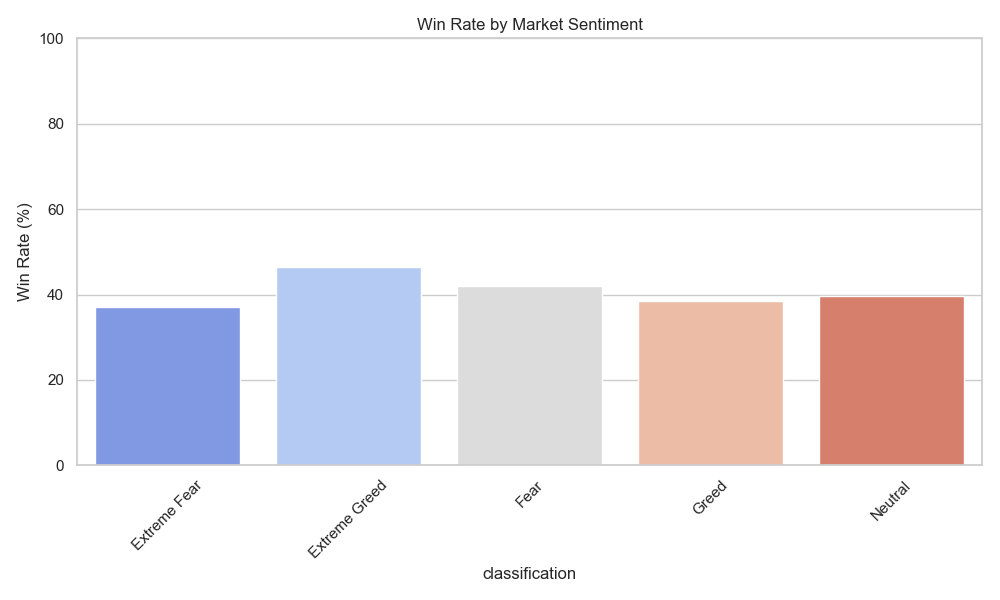
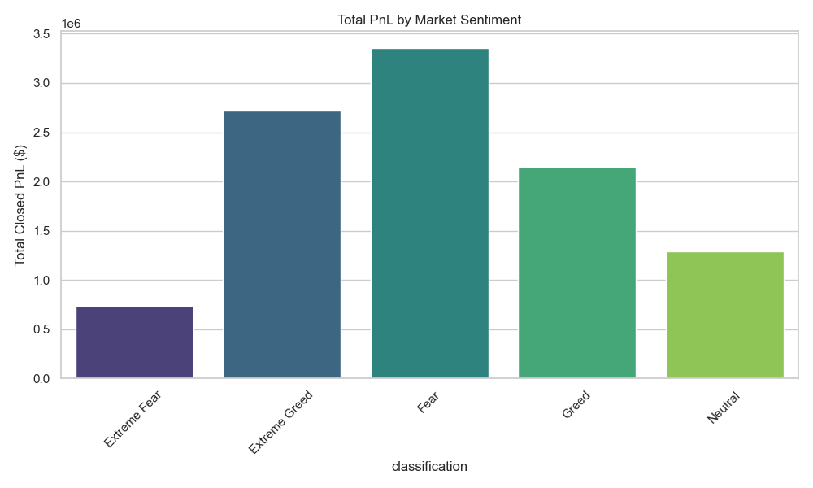
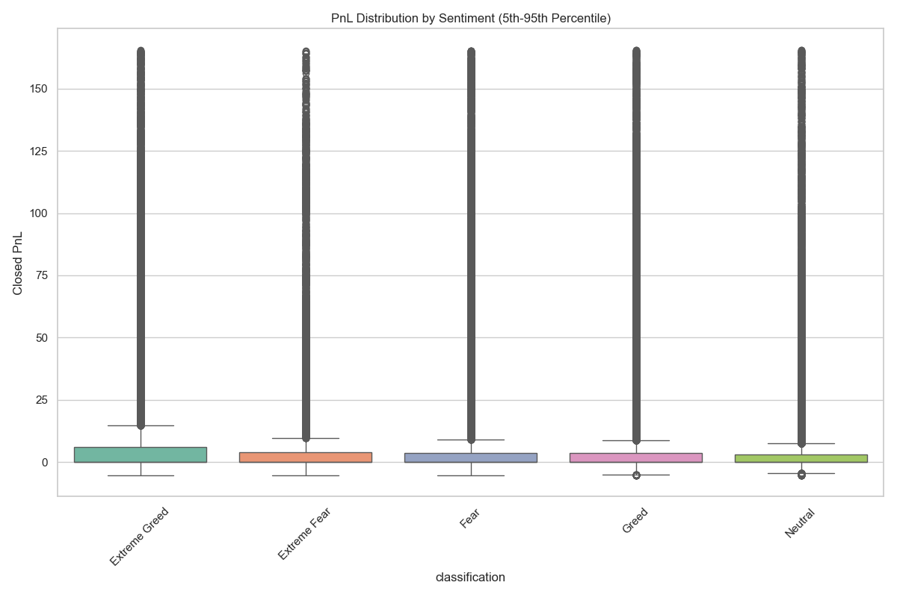
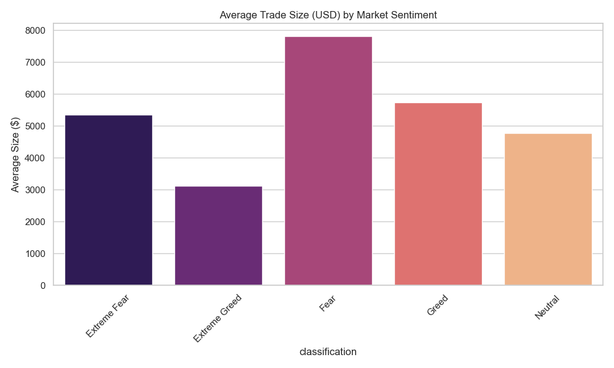

# Bitcoin Sentiment & Trader Performance Analysis Report

## Executive Summary
This report analyzes the relationship between Bitcoin market sentiment (Fear & Greed Index) and trader performance (PnL, Win Rate). The analysis covers **211,218** historical trades matched with daily sentiment data.

**Key Insight:** Traders appear to perform best during **Extreme Greed** market conditions (highest win rate), while **Extreme Fear** correlates with the lowest win rates.

## Methodology
- **Data Sources:**
    - `fear_greed_index.csv`: Daily market sentiment classification.
    - `historical_data .csv`: Historical trader performance data.
- **Process:**
    - Datasets were merged on `date`.
    - Trades were grouped by sentiment classification (`Extreme Fear`, `Fear`, `Neutral`, `Greed`, `Extreme Greed`).
    - Key metrics (Win Rate, Total PnL, Average Trade Size) were calculated for each group.

## Key Findings

### 1. Win Rate by Sentiment
**Extreme Greed** shows the highest win rate (~46.5%), suggesting traders capitalize effectively on strong bullish momentum. Conversely, **Extreme Fear** sees the lowest success rate (~37%).

| Sentiment | Win Rate (%) | Trade Count |
| :--- | :--- | :--- |
| **Extreme Greed** | **46.49%** | 39,992 |
| Fear | 42.08% | 61,837 |
| Neutral | 39.70% | 37,686 |
| Greed | 38.48% | 50,303 |
| Extreme Fear | 37.06% | 21,400 |

### 2. Profit & Loss (PnL) Analysis
While win rates are higher in Extreme Greed, the total PnL distribution varies.

The distribution of PnL across sentiments shows the variability in returns:

### 3. Trade Size Behavior
Average trade sizes may indicate risk appetite during different market conditions.

## Conclusion
- **Momentum Favorability:** The data suggests that "following the herd" during **Extreme Greed** phases has historically yielded higher win rates for this set of traders.
- **Risk in Fear:** Trading during **Extreme Fear** appears riskier, with the lowest probability of profit.
- **Volume:** The highest volume of trades occurred during **Fear** (61k trades), indicating high activity during bearish or uncertain periods, despite average performance.

## Recommendations
- **Strategy Adjustment:** Traders might consider tightening risk management or reducing position sizes during **Extreme Fear** periods due to lower win probabilities.
- **Momentum Trading:** Strategies capitalizing on **Extreme Greed** momentum show promise based on historical win rates.
